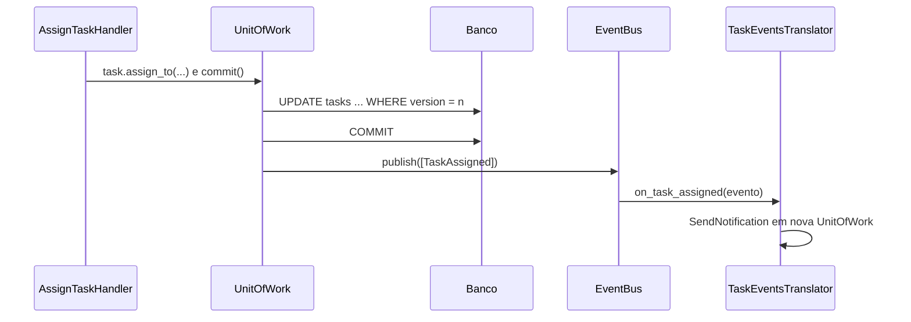

# ADR 0007: Unit of Work e publicação de eventos após o commit

## Status

Aceito. Substitui o [ADR 0003](0003-event-dispatcher-design.md).

## Contexto

Na versão anterior os agregados acumulavam Domain Events, mas nenhum caso de
uso os despachava: os eventos nunca saíam do agregado. Além disso, publicar
eventos *antes* do commit permite que outros contextos reajam a algo que
depois é desfeito.

## Decisão

- `AggregateRoot` registra eventos com `_record()` e os entrega uma única vez
  com `pull_events()`.
- A `UnitOfWork` (camada de aplicação) define o fluxo:
  1. sincroniza os agregados rastreados com a persistência;
  2. faz o commit;
  3. só então coleta os eventos e os entrega ao `EventPublisher`.
- Sair do `async with uow` sem `commit()` (ou com exceção) faz rollback e
  descarta os eventos.
- O `InProcessEventBus` entrega cada evento aos handlers inscritos no seu tipo.
  Falha em um handler é registrada no log e não afeta os demais.
- Um handler de outro contexto abre **a sua própria** Unit of Work: cada
  transação altera um único agregado e a consistência entre agregados é
  eventual (Vernon, regras 1 e 4).

## Consequências

- Nenhum evento é publicado para uma mudança que não foi persistida.
- A entrega em processo é *at-most-once*: se o processo cair entre o commit e a
  publicação, o evento se perde.

## Evolução prevista

Quando eventos precisarem atravessar serviços com garantia de entrega, adotar
**Transactional Outbox**: gravar os eventos numa tabela `outbox` no mesmo commit
do agregado e publicá-los por um relay (*at-least-once*, consumidores
idempotentes). A interface `EventPublisher` e o ponto de coleta na Unit of Work
já são o lugar dessa troca.
