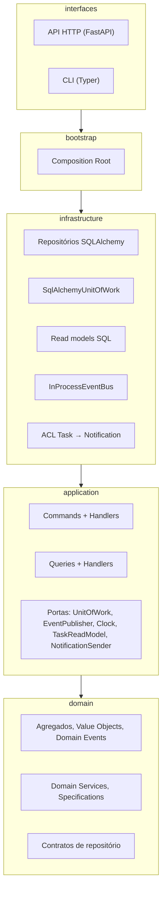

# Arquitetura

## Camadas



As setas são a **regra de dependência**: uma camada só importa as que estão
abaixo dela. O domínio não importa nada além da biblioteca padrão. Tudo isso é
verificado pelo import-linter ([ADR 0009](adr/0009-architecture-contracts-import-linter.md)).

## Caminho de um comando

`POST /api/v1/tasks/{id}/start`

1. **Interface**: o router valida o formato da requisição e chama
   `container.start_task(StartTask(task_id))`. Não decide nada.
2. **Aplicação**: `StartTaskHandler` abre uma Unit of Work, carrega a tarefa e
   as tarefas do responsável pelo repositório e delega ao domínio.
3. **Domínio**: `WorkInProgressPolicy.start` verifica o limite com a
   especificação `InProgressTask`; `Task.start` exige responsável, valida a
   transição de status e registra `TaskStarted`.
4. **Aplicação**: `uow.commit()`.
5. **Infraestrutura**: o repositório copia o agregado para a linha ORM; o
   UPDATE inclui `WHERE version = n`; commit; os eventos são publicados no bus.
6. **Interface**: a resposta é montada pelo lado de leitura (`GetTask`).

Erros seguem o mesmo caminho de volta e viram Problem Details (RFC 9457):

| Erro | Origem | HTTP |
|------|--------|------|
| `InvariantViolation` (ex.: `InvalidTaskTitle`) | Value Object | 422 |
| `BusinessRuleViolation` (ex.: `TaskIsClosed`) | Agregado / Domain Service | 409 |
| `NotFoundError` | Aplicação | 404 |
| `ConcurrencyConflictError` | Unit of Work | 409 |

```json
{
  "type": "about:blank",
  "title": "Conflict",
  "status": 409,
  "detail": "A tarefa precisa de um responsável para ser iniciada.",
  "code": "task_not_assigned",
  "instance": "/api/v1/tasks/3f1c.../start"
}
```

## Mapa dos padrões táticos

| Padrão (Evans / Vernon) | Onde |
|-------------------------|------|
| Entity | `domain/seedwork/entity.py` |
| Aggregate Root | `domain/seedwork/aggregate_root.py`, `domain/task_management/aggregates/task.py` |
| Value Object | `domain/task_management/value_objects/` |
| Domain Event | `domain/task_management/events/task_events.py` |
| Domain Service | `domain/task_management/services/work_in_progress_policy.py` |
| Specification | `domain/seedwork/specification.py`, `domain/task_management/specifications/` |
| Factory | `Task.create`, `Notification.create` |
| Repository (contrato) | `domain/task_management/repositories/task_repository.py` |
| Repository (implementação) | `infrastructure/repositories/sqlalchemy_task_repository.py` |
| Unit of Work | `application/shared/unit_of_work.py`, `infrastructure/unit_of_work.py` |
| Application Service | `application/task_management/commands/` |
| Read Model (CQRS) | `application/task_management/ports/task_read_model.py`, `infrastructure/read_models/` |
| Anti-Corruption Layer | `infrastructure/notification/acl/task_events_translator.py` |
| Composition Root | `bootstrap/container.py` |

## Testes

| Nível | Pasta | O que prova | Dependências |
|-------|-------|-------------|--------------|
| Unitário de domínio | `tests/unit/domain` | Invariantes, transições, eventos, especificações | nenhuma |
| Unitário de aplicação | `tests/unit/application` | Orquestração e publicação pós-commit | fakes em `tests/fakes.py` |
| Integração | `tests/integration` | Mapeamento, Identity Map, rollback, concorrência, fluxo entre contextos | banco real |
| End-to-end | `tests/e2e` | Contrato HTTP e Problem Details | banco real |
| Arquitetura | `lint-imports` | Regra de dependência e independência de contextos | nenhuma |

Integração e e2e usam SQLite por padrão e PostgreSQL quando
`TEST_DATABASE_URL` está definida, como no CI.
