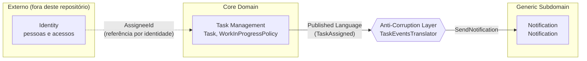

# Context Map

O sistema é dividido em bounded contexts, cada um com seu próprio modelo e sua
própria [Linguagem Ubíqua](ubiquitous-language.md). Este mapa mostra os
contextos, sua classificação estratégica e como se relacionam.

## Contextos

| Contexto | Tipo | Por quê |
|----------|------|---------|
| **Task Management** | Core Domain | É onde está a vantagem do negócio: regras de ciclo de vida, prazos e limite de WIP. Recebe o maior investimento de modelagem e testes. |
| **Notification** | Generic Subdomain | Problema comum a qualquer sistema. Modelo simples; em produção pode ser trocado por um serviço pronto. |
| **Identity** | Externo | Dono das pessoas. Task Management guarda apenas `AssigneeId`. |

## Relacionamentos

### Task Management → Notification: Published Language + Anti-Corruption Layer

- **Upstream**: Task Management. Publica Domain Events com tipos primitivos
  (`TaskAssigned`), que funcionam como Published Language.
- **Downstream**: Notification. Não conhece tarefas nem importa nada do
  upstream.
- **ACL**: `infrastructure/notification/acl/task_events_translator.py` assina
  `TaskAssigned` e o traduz para o comando `SendNotification`, que fala a
  língua de Notification (destinatário e mensagem).
- **Consistência eventual**: a notificação acontece em outra transação, depois
  do commit da atribuição. Uma falha no envio não desfaz a atribuição; ela fica
  registrada como `NotificationFailed`.

### Identity → Task Management: referência por identidade

A tarefa guarda só o identificador do responsável (Vernon, regra 3). Nenhuma
transação altera tarefa e pessoa ao mesmo tempo.

## Shared Kernel e Seedwork

Este repositório **não tem Shared Kernel**. `domain/seedwork/` contém apenas
abstrações técnicas do DDD (`Entity`, `AggregateRoot`, `ValueObject`,
`DomainEvent`, `Specification`), sem nenhum conceito de negócio. Um Shared
Kernel seria um pedaço do *modelo* compartilhado por dois contextos, com
alteração coordenada entre as equipes, e só deve surgir quando esse custo de
coordenação compensar.

## Como a fronteira é garantida

Os contratos `independence` do import-linter impedem imports diretos entre
contextos no domínio e na aplicação (ver [ADR 0009](adr/0009-architecture-contracts-import-linter.md)).
