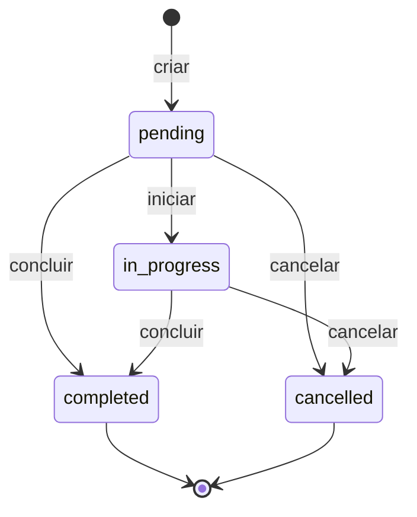

# Linguagem Ubíqua

Termos usados por especialistas de negócio e desenvolvedores, com um único
significado dentro de cada bounded context. O mesmo termo aparece nas
conversas, nos documentos e no código (classes, métodos, eventos, endpoints).
Ao mudar o negócio, mude primeiro este glossário e depois o código.

## Task Management (Core Domain)

| Termo | Significado | No código |
|-------|-------------|-----------|
| **Tarefa** (Task) | Unidade de trabalho com título, prioridade, prazo e responsável. Raiz do agregado. | `Task` |
| **Título** | Nome curto da tarefa: obrigatório, até 120 caracteres, espaços normalizados. | `TaskTitle` |
| **Descrição** | Detalhamento opcional, até 2000 caracteres. | `TaskDescription` |
| **Prioridade** | Urgência relativa: `low`, `medium`, `high`, `urgent`. | `TaskPriority` |
| **Prazo** (Due date) | Data limite. Não pode ser anterior à criação da tarefa. | `DueDate` |
| **Responsável** (Assignee) | Pessoa que executa a tarefa. Pertence a outro contexto; a tarefa guarda só a identidade. | `AssigneeId` |
| **Atribuir** | Definir ou trocar o responsável. | `Task.assign_to` → `TaskAssigned` |
| **Iniciar** | Começar a execução. Exige responsável e respeita o limite de WIP. | `WorkInProgressPolicy.start` → `TaskStarted` |
| **Concluir** | Encerrar com sucesso, registrando quando. | `Task.complete` → `TaskCompleted` |
| **Cancelar** | Encerrar sem execução. | `Task.cancel` → `TaskCancelled` |
| **Repriorizar** | Mudar a prioridade de uma tarefa aberta. | `Task.reprioritize` → `TaskPriorityChanged` |
| **Tarefa aberta** | Tarefa `pending` ou `in_progress`: ainda pode mudar. | `TaskStatus.is_open`, `OpenTask` |
| **Tarefa encerrada** | Tarefa `completed` ou `cancelled`: imutável. | `TaskIsClosed` |
| **Tarefa atrasada** | Tarefa aberta cujo prazo já passou. | `Task.is_overdue`, `OverdueTask` |
| **WIP** (work in progress) | Quantidade de tarefas em andamento de um mesmo responsável. Limite configurável. | `WorkInProgressPolicy` |

### Ciclo de vida

## Notification (Generic Subdomain)

| Termo | Significado | No código |
|-------|-------------|-----------|
| **Notificação** | Aviso a um destinatário. Processada uma única vez. | `Notification` |
| **Destinatário** | Quem recebe o aviso. | `Recipient` |
| **Mensagem** | Texto do aviso, até 500 caracteres. | `Message` |
| **Enviada / Falhou** | Resultado do processamento pelo canal de entrega. | `NotificationSent`, `NotificationFailed` |
| **Canal de entrega** | Meio técnico (e-mail, push, chat) usado para enviar. | `NotificationSender` |

## Termos que mudam de significado entre contextos

| Termo | Em Task Management | Em Notification |
|-------|--------------------|-----------------|
| Pessoa | **Responsável** por executar uma tarefa | **Destinatário** de um aviso |

A tradução entre os dois acontece na Anti-Corruption Layer
(`infrastructure/notification/acl/`), ver [context map](context-map.md).
